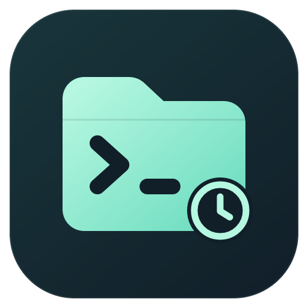

# OpenCode History



Browse and manage your local OpenCode conversation history directly in VS Code, grouped by workspace folder, and reopen any session terminal in its original working directory.

This is an unofficial community extension, independently maintained; it is not an official extension from the engine vendor.

## Features

- **Workspace-grouped history** — every OpenCode session found on your machine, grouped by its original working directory, with parent and child sessions nested.
- **Search and archive filter** — search session titles or folder paths, and switch between Unarchived, Archived, and All views.
- **Read-only preview** — page through a full transcript without any cap or truncation; links and images stay inert, so reading history never fetches a remote URL.
- **Resume in place** — right-click a main session to open an OpenCode terminal in its original working directory with the exact session id; reopening focuses the existing terminal instead of duplicating it.
- **Archive management** — archive or unarchive sessions through the engine's official API; archiving keeps the conversation body.
- **Recoverable delete** — before anything is removed, the affected sessions are listed, a private local backup is created, and the backup is proven restorable in an isolated verification host. Deletes with unfinished messages, queued input, or detected running tasks are refused.
- **Restore Backup** — bring deleted sessions back with their verified conversation bodies, parent/child relations, original directories, and archive state.
- **Static and lightweight** — history is read only when you press **Refresh**; nothing runs in the background. A running OpenCode background service is reused; otherwise each read uses a temporary private server that is stopped right afterwards. A new window shows the last refresh from a small saved snapshot without starting anything.
- **Legacy record support** — leftover V1 records are marked separately, support read-only preview and local archiving, and can be imported into the new version through an explicit, confirmed step.

## Requirements

- Windows x64.
- VS Code 1.144.0 or later.
- The OpenCode engine (validated with OpenCode 2.2.5), installed separately. The extension discovers the native `opencode.exe` automatically; you can also point it to the exact path with the `opencodeHistory.enginePath` setting or the **Select Engine** command.

## Getting started

1. Install the extension and open the **OpenCode History** view in the Activity Bar.
2. The first read enumerates every session on the machine. If reading fails, click **Refresh**, then use the gear icon to select your local `opencode.exe`; the view keeps the last successful content and shows the error.
3. Expand a folder, right-click a session to preview it, archive it, or open its terminal in the original directory.
4. Use **Delete (Recoverable)** when you want a removable record: the extension shows the exact scope first, creates and verifies a private backup, and only then deletes. **Restore Backup** brings sessions back if you change your mind.

## How refreshing works

- The list is static: press **Refresh** to re-read it; the header shows when it was last refreshed. Archive, delete, restore and legacy import refresh once after they finish. Nothing re-reads on its own (no event stream, no polling, no focus or visibility refresh).
- Between refreshes the extension runs no process. If the OpenCode background service is already running it is reused and never stopped; otherwise a temporary private `opencode serve` on 127.0.0.1 handles the read and is stopped right after it.
- A new VS Code window shows the last refresh from a small snapshot in the extension's storage, without starting any process.
- A "Running" badge reflects the moment of the last refresh. When another process's running state cannot be confirmed, it stays unknown rather than being guessed.

## Deletion, backup, and recovery

- Deleting is scoped by parent/child relations (never by directory containment) and always preceded by a private local backup that covers the verified conversation bodies and key metadata.
- The stored backup must survive an official import and readback inside an isolated verification host before anything is deleted.
- OpenCode 2.2.5 provides no cross-process atomic delete: stop tasks that still use the affected sessions in other windows, and do not keep writing while the deletion runs. When in doubt, archive instead of deleting.
- The extension reports partial successes and unconfirmed outcomes explicitly; it never silently retries a delete against an unverified, changing tree.
- Restoring never overwrites existing sessions; conflicts are reported.
- Recovery backups live in the extension's private local storage and are not purged automatically. The extension never uploads conversations, and the packages contain no history data.

## Legacy (V1) records

Records written by an older OpenCode after the v1-to-v2 migration are invisible to the current engine API. They are listed with a clear badge, can be previewed read-only and archived locally, and can be imported into the new version through **Import Legacy Record into New Version** (explicit and confirmed; only verified formats convert, the original rows are preserved, and no model requests are made). Installing and normal browsing never auto-import legacy data.

## Known limitations

- Windows x64 only; validated against OpenCode 2.2.5 (other engine versions are untested).
- Opening an OpenCode terminal requires a trusted workspace; read-only browsing works everywhere.
- Preview does not fetch remote transcript images or links (they are shown as inert text).
- Cross-process deletion cannot be atomic; the extension refuses unsafe deletes instead of promising impossibilities.
- This is not an official extension from the engine vendor.

## Building and testing from source

```powershell
npm ci
npm test            # default synthetic test suites
node test/run-backend.cjs   # backend native suites (see OPENCODE_BACKEND_TEST_ENGINE)
$env:OPENCODE_TEST_ENGINE = '<absolute path to opencode.exe>'
npm run test:extension      # isolated extension-host suites
npm run package     # vsce package --target win32-x64 --readme-path MARKETPLACE.md
```

All tests use isolated synthetic data; no model requests are made and no real conversation data is touched.

## License

MIT. Reuses grouping, paging, rendering, and terminal-management implementations from the Muse History Sidebar; copyright and attribution are in the bundled `LICENSE` file.
