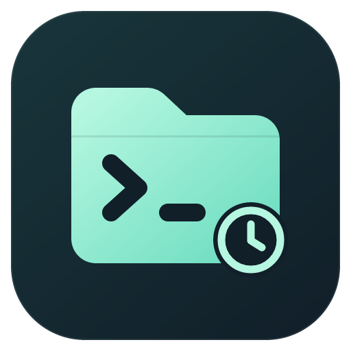

# OpenCode History Sidebar



Unofficial community VS Code extension for browsing and managing local OpenCode conversation history by workspace folder. This project is independently maintained and is not an official extension from the engine vendor. Starting with version 0.1.1, the extension UI, Marketplace listing, and packaging are English; this repository guide is bilingual (English below, 中文指南在下半部分).

## Usage

- Open **OpenCode History** in the Activity Bar and expand a folder to see main sessions and their child sessions.
- Use the magnifier in the view header to search titles or directories, and the funnel to filter by archive state (Unarchived / Archived / All).
- Right-click a session and choose **Read-only Preview**. Content loads page by page; when new content is detected beyond the loaded range, click **Load to Latest**.
- Right-click a main session to open an OpenCode terminal in its original working directory; child sessions offer an entry to open the parent main session's terminal.
- Right-click to **Archive** or **Unarchive**. Archiving keeps the conversation body.
- **Delete (Recoverable)** lists every affected session first, then creates a private local backup and verifies it can actually be restored before anything is removed. It refuses to delete when unfinished messages, queued input, known running tasks, or changes during the backup are detected.
- Click **Restore Backup** in the view header to pick a backup and restore it. The restore scope is the verified conversation bodies, parent/child relations, original directories, and archive metadata; your project files are not part of this backup.

The list is **static** (since 0.2.0): it is re-read only when you press **Refresh** or after an action that changes sessions (archive, delete, restore, legacy import), and the header shows when it was last refreshed. There is no event stream, polling, or focus/visibility refresh. Between refreshes the extension runs no process: an already running OpenCode background service is reused and never stopped; when none is running, each read uses a temporary private `opencode serve` on 127.0.0.1 that is stopped (with its process tree) right after the read — the resident background service is no longer started by the extension. A new VS Code window shows the last refresh from a small JSON snapshot in the extension's storage without starting anything; only a first-ever start reads once. Previews load the Markdown renderer on first use, render only new entries on "Load More", and release their page when the tab is hidden. When the running state of another process cannot be confirmed, it stays unknown.

Before deleting, stop tasks that still use the affected sessions in other windows, and do not keep writing while the deletion runs. OpenCode 2.2.5 cannot provide a cross-process atomic delete; when you cannot confirm that other tasks have stopped, archive instead of deleting. The extension reports known partial successes and unconfirmed outcomes, but it cannot promise to catch every concurrent change after its final recheck.

Legacy leftover records are marked separately and support read-only preview and local archiving. To continue such a session or delete it, first run **Import Legacy Record into New Version** and confirm; only verified formats are imported, everything else stays previewable. Installing and normal browsing never auto-import legacy data.

This extension does not upload conversations, and previews never fetch remote links or images. Recovery backups contain the original conversation text and are stored in the extension's private local directory; they are not purged automatically. Neither the packages nor the source repository contain your history or backups.

If reading fails, click Refresh first, then use the gear to select your local `opencode.exe`. The view keeps the content of the last successful read and shows the error.

## Requirements

- Windows x64; VS Code 1.144.0 or later. Validated with OpenCode 2.2.5. The OpenCode engine must be installed separately.
- Preview does not fetch remote transcript images or links. No conversation data, account credentials, or recovery backups are included in this repository.

Install the Windows VSIX from [GitHub Releases](https://github.com/Great-us/opencode-history-sidebar/releases). The publisher ID in local packages is `AlexWonton`; Marketplace packages use the AlexWonton publisher identity.

## Development

Keep `package-lock.json` and use the locked dependencies:

```powershell
npm ci
npm test
node test/run-backend.cjs
$env:OPENCODE_TEST_ENGINE = '<absolute path to your opencode.exe>'
npm run test:extension
npm run package
```

`npm test` runs the default synthetic test suites only. The backend native suites can be pointed at an engine via `OPENCODE_BACKEND_TEST_ENGINE`; the extension-host suites require `OPENCODE_TEST_ENGINE`. Native tests use isolated synthetic data and send no model requests. The package target is Windows x64, and the store README comes from `MARKETPLACE.md` via `vsce package --readme-path MARKETPLACE.md`.

## Switching from the local build

The store version uses the AlexWonton publisher, which is a different extension ID from the earlier `local-opencode-tools` local builds. Archive marks in the local view and terminal adoption records do not migrate automatically; keep the old version around, close its terminals, and only then start using the store version. The engine's conversation files stay where they are.

## License

MIT. Reuses grouping, paging, rendering, and terminal-management implementations from the Muse History Sidebar; copyright and attribution are in the bundled `LICENSE` file.

---

# OpenCode 历史记录

本地定制的 VS Code 扩展，扩展 ID 为 `AlexWonton.opencode-history-sidebar`。按文件夹管理本机 OpenCode 会话，可与 Muse Desktop 和 Muse 历史侧栏共存。当前版本面向 OpenCode 2.2.5、VS Code 1.144.0。自 0.1.1 起，扩展界面、商店页面与打包说明为英文；本仓库指南保持双语。

## 使用

- 打开活动栏的 **OpenCode 历史记录**，展开文件夹查看主会话与子会话。
- 用标题栏的放大镜搜索标题或目录，用漏斗筛选归档状态（未归档 / 已归档 / 全部）。
- 右键会话选择 **只读预览**。内容分页加载；出现新内容提示时，点 **加载到最新**。
- 右键主会话可在原目录打开 OpenCode 终端；子会话提供打开父主会话的入口。
- 右键归档或取消归档。归档保留正文。
- **删除（可恢复）**会列出受影响的会话，并先生成本地备份、验证恢复能力。检测到未完成消息、排队输入、已知运行任务或备份期间的变化时会拒绝删除。
- 点标题栏的 **恢复备份**选择记录还原。恢复范围是已验证的对话正文、父子关系、原目录及归档等元数据，项目文件不在此备份范围。

列表是**静态**的（0.2.0 起）：只有点“刷新”或执行会改变会话的操作（归档、删除、恢复、导入旧版记录）后才重新读取，标题栏显示上次刷新时间。没有事件流、轮询、切回窗口或显示侧栏时的自动刷新。两次刷新之间扩展不运行任何进程：已在运行的 OpenCode 后台服务会被复用且绝不停止；没有后台服务时，每次读取临时启动一个仅监听 127.0.0.1 的私有 `opencode serve`，读完立即连同子进程一起停止——扩展不再启动常驻后台服务。新开 VS Code 窗口直接显示扩展存储中上次刷新的小型 JSON 快照，不启动任何进程；只有首次使用时会读取一次。预览首次打开才加载 Markdown 渲染器，“加载更多”只渲染新内容，标签页隐藏时释放页面。其他进程的运行状态无法确认时保留为未知。

删除前请先停止其他窗口中相关会话的任务，删除过程中不要继续写入。OpenCode 2.2.5 无法提供跨进程的原子删除；无法确认其他任务已停止时，请先归档或取消。本扩展会报告已知的部分成功或未确认结果，无法保证发现最终复核之后所有并发变化。

旧版遗留记录会单独标注，支持只读预览和本地归档。需要继续会话或删除时，先选 **将旧版记录导入新版**并确认；仅导入经过验证的格式，其他格式仍可预览。安装和普通浏览不会自动导入旧数据。

本扩展不上传对话，预览不会自动访问外链或图片。恢复备份含原始正文，保存在扩展的本地私有目录中，不自动清除。安装包与源码包不包含你的历史或备份。

如果读取失败，可先点刷新，再使用齿轮选择本机 `opencode.exe`。界面会保留上次成功读取的内容并显示错误。

## 环境要求

- Windows x64；VS Code 1.144.0 或更高版本。已用 OpenCode 2.2.5 验证。引擎须单独安装。
- 预览不获取远程图片或链接。本仓库不包含对话数据、账号凭据或恢复备份。

从 [GitHub Releases](https://github.com/Great-us/opencode-history-sidebar/releases) 安装 Windows VSIX。本地包发布者 ID 为 `AlexWonton`；商店包使用 AlexWonton 发布者身份。

## 开发

保留 `package-lock.json`，使用锁定依赖：

```powershell
npm ci
npm test
node test/run-backend.cjs
$env:OPENCODE_TEST_ENGINE = '<本机 opencode.exe 的绝对路径>'
npm run test:extension
npm run package
```

`npm test` 只运行默认合成测试。后端原生测试可通过 `OPENCODE_BACKEND_TEST_ENGINE` 指定引擎路径，扩展宿主测试需要 `OPENCODE_TEST_ENGINE`。原生测试使用隔离的合成数据，不发送模型请求。打包目标为 Windows x64，商店 README 由 `MARKETPLACE.md` 经 `vsce package --readme-path MARKETPLACE.md` 提供。

## 从本地构建切换

商店版本使用 AlexWonton 发布者，与此前 local-opencode-tools 本地构建是不同扩展 ID。本地视图归档标记和终端认回记录不会自动迁移；切换前请保留旧版，并关闭其对应终端后再使用商店版。引擎中的对话文件仍在原处。

## 许可

MIT。复用部分 Muse 历史侧栏的分组、分页、渲染与终端管理实现；版权和署名见随包提供的 `LICENSE` 文件。
